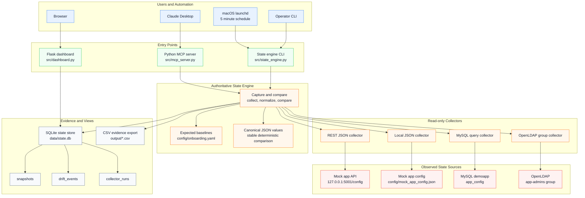

# Continuous State Governance PoC Architecture

## Flow

1. A capture is triggered by the CLI, macOS `launchd`, or an MCP tool call from Claude Desktop.
2. `src/state_engine.py` loads expected baselines from `config/onboarding.yaml`.
3. The state engine invokes each configured read-only collector.
4. Collector outputs are normalized into canonical JSON strings.
5. The normalized observed value is compared deterministically with the expected value.
6. The run is stored in SQLite as snapshots, drift events, and collector-run health records.
7. The dashboard reads the latest SQLite state directly; it does not run collectors.
8. CSV export writes current evidence files under `output/`.

## Status Model

- `MATCH`: collector succeeded and observed state equals the expected baseline.
- `DRIFT`: collector succeeded and observed state differs from the expected baseline.
- `UNKNOWN`: collector failed, so the system cannot attest to the control.

`UNKNOWN` is intentionally separate from `DRIFT`. A failed collector does not prove that the underlying control changed.
